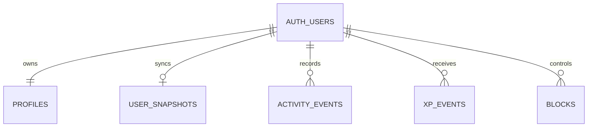

# What the databases store

## Running app: native SQLite

`ramadan-journey.db` stores one versioned application snapshot in `app_state`. It includes appearance/language, onboarding, season configuration, date-keyed prayer/fasting records and notes, personal goals, daily habits, reading plans and page confirmations, Quran bookmarks and last selection, selected reciter/tafsir and page-fit preference. Zoom and immersive mode remain temporary UI state. It contains no Quran PNGs, MP3s or tafsir corpus.

Saving uses a parameterized upsert and a serialized write queue. The snapshot is validated on restore; unknown schemas fail visibly instead of replacing private data. Browser preview uses localStorage in its own origin. The native SQLite SQL is additionally tested through Node's SQLite engine across a real close/reopen; that does not prove the Expo native bridge on an Android device.

Local SQLite uses the operating-system application sandbox; this preview does not claim SQLCipher encryption or a cloud backup. Removing the app can remove local records. Export is initiated by the user and includes private notes.

Android app configuration explicitly sets `allowBackup: false` rather than inheriting the template's automatic Google backup default. Microphone, external-storage, overlay-window and vibration permissions are blocked. The final merged APK manifest must be checked as part of the release record. See the [Expo app configuration reference](https://docs.expo.dev/versions/v58.0.0/config/app/) and [permission configuration](https://docs.expo.dev/guides/permissions/).

## Prepared cloud foundation: Supabase/PostgreSQL

| Table | Purpose | Access |
|---|---|---|
| `profiles` | Alias, language/theme, explicit board opt-in and adult-consent flag | Owner only; public projection via RPC |
| `user_snapshots` | Private backup/sync document + revision | Owner read; CAS writes through RPC |
| `activity_events` | Minimal app-participation events | Owner read; server function writes |
| `xp_events` | Immutable client-facing award ledger, rule version, server date | Owner read; no client write grants |
| `blocks` | Per-user block list | Owner read/write |

### Implemented SQL RPCs

- `sync_state(p_expected_revision bigint, p_payload jsonb) -> bigint`: authenticated own-user compare-and-swap, JSON version 1, 2 MiB ceiling. Stale revisions raise `SYNC_CONFLICT` with SQLSTATE `40001`. Conflict resolution must be explicit; this is not silent last-write-wins merging.
- `record_activity(p_source_id uuid, p_kind text, p_payload jsonb) -> integer`: validated personal participation actions. Server date, unique source IDs, one daily check-in/weekly review scope, per-user locking, 100 XP/day cap. Reading completion is self-reported participation, not proof of worship. Sensitive notes are discarded from this ledger.
- `get_leaderboard(p_limit integer, p_offset integer)`: bounded projection of consented aliases and award totals, filtering blocks. It does not return prayers, fasting details or notes. This initial SQL projection is all-time; seasonal/friends/group ranking is not implemented.
- `delete_my_account()`: authenticated own-account removal with cascading private/XP/profile records. A mobile caller must provide explicit user confirmation before invoking deletion.

### Local PostgreSQL verification

`npm test` runs the migration on PGlite PostgreSQL with two test users and a **test-only** `auth.uid()` shim. Tests cover cross-user isolation, forbidden direct revision/XP edits, stale-sync rejection, idempotency, 100 XP cap, note exclusion, private-by-default ranking, opt-out, and deletion cascade. Production must use Supabase Auth's verified JWT identity, never the test shim.

### What still requires a hosted project

No cloud database instance or real account was created during this work. Provision your Supabase project, apply the migration, configure Auth/email/recovery and the app's public URL/key, and repeat authorization tests against the deployed service before connecting mobile sign-in or sync. A public anon/publishable key is not a `service_role` key; the latter must never enter the app.

The current mobile build has no live Auth/sync/social screen. A complete cloud release additionally needs secure token storage, guest/account data separation and migration, a durable per-account outbox/conflict UI, account deletion confirmation, abuse/moderation controls, and real network E2E tests. Challenges, achievements and rewards need separate reviewed migrations and mobile flows; they are not represented as complete by this foundation.
